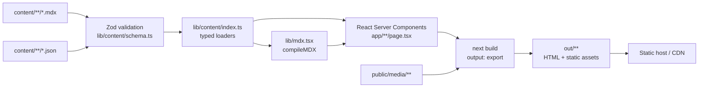
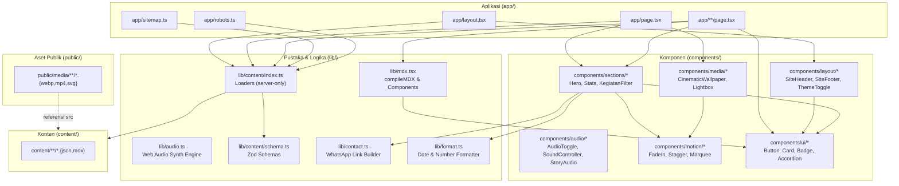

# Architecture & Technical Design — KSR PMI Unit Universitas Telkom

Dokumen arsitektur teknis lengkap untuk situs profil web KSR PMI Unit Universitas Telkom.

## Tech Stack

Pilihan teknologi dirancang untuk performa tinggi, keandalan jangka panjang, kesederhanaan operasional, dan hasil build statis tanpa ketergantungan pada runtime server.

| Kategori / Paket              | Versi Terkunci                                                                                                                                  | Alasan & Peran Teknis                                                                                                          |
| ----------------------------- | ----------------------------------------------------------------------------------------------------------------------------------------------- | ------------------------------------------------------------------------------------------------------------------------------ |
| **Runtime & Package Manager** | **Bun** `1.4.3`                                                                                                                                 | Eksekusi TypeScript sangat cepat, lockfile `bun.lock`, script memanfaatkan `bun --bun next …`.                                 |
| **Framework**                 | **Next.js** `16.4.2` (App Router)                                                                                                               | Static export (`output: 'export'`), React Server Components (RSC) tanpa overhead hidrasi berlebih. Turbopack default aktif.    |
| **UI Library**                | **React** `19.3.1` & **React DOM** `19.3.1`                                                                                                     | Fondasi komponen modern, dukungan penuh untuk primitive RSC dan kompilasi statis.                                              |
| **Bahasa Pemrograman**        | **TypeScript** `5.9.3`                                                                                                                          | Pengetikan statis ketat (`strict`, `noUncheckedIndexedAccess`, `verbatimModuleSyntax`) untuk integritas skema data.            |
| **CSS Framework**             | **Tailwind CSS** `4.3.3` (`@tailwindcss/postcss`)                                                                                               | Engine CSS performa tinggi tanpa konfigurasi JS berbelit, pemanfaatan `@theme inline` dan CSS variables.                       |
| **Animasi**                   | **Motion** `14.5.0` (fka Framer Motion)                                                                                                         | Animasi sinematik terukur, kontrol transisi GPU, kepatuhan `prefers-reduced-motion`.                                           |
| **Tema Antarmuka**            | **next-themes** `0.4.6`                                                                                                                         | Pengelolaan tema dual (light warm-paper & dark near-black) dengan atribut `data-theme` tanpa kedipan layout (FOUC).            |
| **Validasi Skema**            | **Zod** `4.6.7`                                                                                                                                 | Validasi tipe runtime konten Markdown/JSON saat fase build; gagal kompilasi jika data tidak valid.                             |
| **MDX Parser**                | **next-mdx-remote-client** `2.1.12`                                                                                                             | Pengolahan berkas MDX server-side statis tanpa kompilasi webpack runtime berlebih.                                             |
| **Tipografi Swahosting**      | `@fontsource-variable/plus-jakarta-sans` `5.3.0` & `@fontsource-variable/jetbrains-mono` `5.3.0`                                                | Font variabel lokal mandiri tanpa permintaan jaringan eksternal ke server Google Fonts.                                        |
| **Graf Pengetahuan Kode**     | `@sentropic/engram` `0.21.1`                                                                                                                    | Analisis AST deterministik berbasis tree-sitter untuk memetakan arsitektur dan relasi modul (bin `engram` + alias `graphify`). |
| **Linting & Formatting**      | `eslint` `9.39.5`, `eslint-config-next` `16.4.2`, `eslint-config-prettier` `10.1.8`, `prettier` `3.9.10`, `prettier-plugin-tailwindcss` `0.8.1` | Standar konsistensi kode. Catatan: Next 16 telah meniadakan `next lint` bawaan; lint dijalankan via perintah `eslint .`.       |
| **Utilitas Pendukung**        | `clsx` `2.1.1`, `remark-gfm` `4.0.1`                                                                                                            | Penggabungan kelas Tailwind kondisional dan penguraian tabel/tasklist GitHub Flavored Markdown pada MDX.                       |
| **Deklarasi Tipe**            | `@types/node` `26.6.5`, `@types/react` `19.3.0`, `@types/react-dom` `19.3.0`                                                                    | Definisi tipe statis lengkap untuk Node.js dan React 19.                                                                       |

_Catatan Turbopack Next.js 16_: Next.js 16 mengaktifkan Turbopack secara default. Jika terjadi kendala pada lingkungan Bun, tambahkan flag `--webpack` pada perintah `next build` tanpa menurunkan versi framework.

## Data Flow

Data mengalir secara deterministik pada saat kompilasi (_build-time_). Tidak ada API server runtime, tidak ada komunikasi basis data dinamis, dan tidak ada pemanggilan `fetch()` ke endpoint backend internal.



### Tahapan Aliran Data Build-Time

1. **Pembacaan Berkas Mentah (File System Read)**: Modul `lib/content/index.ts` membaca berkas teks MDX dan JSON dari direktori `content/` menggunakan modul bawaan `node:fs`.
2. **Pemisahan Frontmatter & Isi**: Berkas MDX diurai atribut _frontmatter_ dan blok tubuh teksnya menggunakan `next-mdx-remote-client`.
3. **Validasi Skema Zod Ketat**: Metadata JSON dan frontmatter MDX dimasukkan ke dalam validator Zod (`lib/content/schema.ts`). Jika ada properti yang tidak sesuai (misalnya format tanggal salah, URL tidak valid, field wajib hilang), proses build langsung berhenti (_fail-fast_) dengan pesan kesalahan mendetail.
4. **Penyaluran Loader Bertipe (Typed Loaders)**: Komponen React Server Components (`app/**/page.tsx`) memanggil fungsi loader khusus (seperti `getKegiatanList()`, `getSiteConfig()`) yang mengembalikan data bertipe penuh.
5. **Kompilasi RSC & MDX**: Server Components mengompilasi markup HTML statis. Berkas MDX dirender menjadi elemen React yang aman dengan komponen kustom (tabel, gambar responsif, kutipan).
6. **Ekspor Statis (Static HTML Generation)**: Mesin `next build` menghasilkan berkas HTML, CSS, JavaScript bundel minimum, dan aset statis ke folder `out/` yang siap dideploy ke peladen statis manapun (Netlify, Vercel, Cloudflare Pages, atau GitHub Pages).

_Karakteristik Runtime_:
Pada saat situs dimuat di peramban pengguna, hanya komponen interaktif (_islands_) seperti `SiteHeader`, `ThemeToggle`, `Lightbox`, `KegiatanFilter`, dan `CinematicWallpaper` yang melakukan hidrasi JavaScript. Seluruh konten teks, tabel, bagan, dan artikel disajikan langsung sebagai HTML murni tanpa permintaan data sekunder.

## Database Schema

MVP KSR PMI Unit Universitas Telkom tidak memiliki basis data relasional (SQL), tidak memakai ORM (Prisma/Drizzle), tidak memerlukan migrasi skema, dan tidak menjalankan query runtime. Sumber kebenaran tunggal persistensi data adalah repositori Git itu sendiri dan berkas-berkas di folder `content/`.

Skema di bawah ini adalah **kontrak skema Zod** yang didefinisikan pada `lib/content/schema.ts` untuk memvalidasi berkas konten saat proses kompilasi.

### 1. `SiteConfig` (`content/site.json`)

| Field           | Tipe                 | Wajib | Catatan                                                                                                     |
| --------------- | -------------------- | ----- | ----------------------------------------------------------------------------------------------------------- |
| `name`          | `string`             | Ya    | Nama resmi: "KSR PMI Unit Universitas Telkom".                                                              |
| `shortName`     | `string`             | Ya    | Nama ringkas: "KSR PMI Tel-U".                                                                              |
| `tagline`       | `string`             | Ya    | Moto singkat organisasi.                                                                                    |
| `description`   | `string`             | Ya    | Deskripsi ringkas untuk meta tag SEO (panjang 80–160 karakter).                                             |
| `url`           | `string (url)`       | Ya    | URL produksi resmi situs.                                                                                   |
| `contentStatus` | `'dummy' \| 'final'` | Ya    | Saklar konten. Menentukan noindex, footer note, dan build warning.                                          |
| `foundedAt`     | `string (ISO date)`  | Ya    | Tanggal pendirian: `2013-11-10`.                                                                            |
| `decree`        | `string`             | Ya    | SK Rektor: `KEP.010/ORG22/WR4.0/2014`.                                                                      |
| `affiliation`   | `string`             | Ya    | Naungan: "PMI Kabupaten Bandung".                                                                           |
| `university`    | `string`             | Ya    | Universitas: "Universitas Telkom".                                                                          |
| `period`        | `string`             | Ya    | Format periode kepengurusan aktif: `YYYY-YYYY` (contoh: `2024-2025`).                                       |
| `address`       | `object`             | Ya    | Objek alamat: `{ label, street, city, region, postalCode, mapsUrl, mapsEmbedUrl }`.                         |
| `contact`       | `object`             | Ya    | Narahubung resmi: `{ email, phone, whatsapp }`.                                                             |
| `socials`       | `array of object`    | Ya    | Daftar akun media sosial: `[{ platform: 'instagram'\|'tiktok'\|'youtube'\|'linkedin'\|'x', url, handle }]`. |
| `links`         | `object`             | Ya    | Tautan luar: `{ registration, serviceRequest, donation? }`.                                                 |
| `stats`         | `array of object`    | Ya    | Statistik ringkas: `[{ label, value, suffix? }]`.                                                           |
| `nav`           | `array of object`    | Ya    | Struktur navigasi menu: `[{ label, href, children? }]`.                                                     |

### 2. `Media` (Tipe Reusable untuk Gambar & Video)

| Field    | Tipe                 | Wajib | Catatan                                                          |
| -------- | -------------------- | ----- | ---------------------------------------------------------------- |
| `src`    | `string`             | Ya    | Lokasi berkas media lokal, wajib diawali `/media/`.              |
| `alt`    | `string`             | Ya    | Teks alternatif deskriptif (panjang minimal 1 karakter).         |
| `type`   | `'image' \| 'video'` | Ya    | Jenis berkas media.                                              |
| `poster` | `string`             | Tidak | Lokasi berkas poster untuk video, wajib bila `type === 'video'`. |
| `credit` | `string`             | Tidak | Atribusi fotografer atau sumber dokumentasi.                     |
| `width`  | `number`             | Ya    | Lebar intrinsik media dalam piksel.                              |
| `height` | `number`             | Ya    | Tinggi intrinsik media dalam piksel.                             |

### 3. `Anggota`

| Field          | Tipe     | Wajib | Catatan                                           |
| -------------- | -------- | ----- | ------------------------------------------------- |
| `nama`         | `string` | Ya    | Nama lengkap pengurus/relawan.                    |
| `jabatan`      | `string` | Ya    | Jabatan fungsional dalam kepengurusan.            |
| `foto`         | `Media`  | Tidak | Objek foto profil anggota (opsional/placeholder). |
| `programStudi` | `string` | Tidak | Program studi di Telkom University.               |
| `angkatan`     | `string` | Tidak | Tahun angkatan perkuliahan.                       |
| `instagram`    | `string` | Tidak | Akun Instagram profil.                            |
| `linkedin`     | `string` | Tidak | Akun LinkedIn profil.                             |

### 4. `Kabinet` (`content/kepengurusan/periode/<YYYY-YYYY>.json`)

| Field      | Tipe          | Wajib | Catatan                                                                         |
| ---------- | ------------- | ----- | ------------------------------------------------------------------------------- |
| `periode`  | `string`      | Ya    | Format rentang tahun `YYYY-YYYY` (contoh: `2024-2025`).                         |
| `motto`    | `string`      | Ya    | Semboyan kabinet periode tersebut.                                              |
| `komandan` | `Anggota`     | Ya    | Profil komandan kabinet terpilih.                                               |
| `wakil`    | `Anggota[]`   | Ya    | Daftar wakil komandan (minimal 1 orang).                                        |
| `inti`     | `Anggota[]`   | Ya    | Pengurus harian inti (Sekretaris, Bendahara, dll).                              |
| `divisi`   | `DivisiRef[]` | Ya    | Daftar divisi kabinet beserta anggotanya: `{ slug, nama, anggota: Anggota[] }`. |
| `foto`     | `Media`       | Tidak | Foto bersama kabinet.                                                           |

### 5. `DivisiPage` (`content/divisi/<slug>.mdx`)

| Field          | Tipe       | Wajib | Catatan                                                    |
| -------------- | ---------- | ----- | ---------------------------------------------------------- |
| `title`        | `string`   | Ya    | Nama divisi lengkap.                                       |
| `slug`         | `string`   | Ya    | Pengenal unik URL (kebab-case).                            |
| `singkat`      | `string`   | Ya    | Ikhtisar peran divisi (1–2 kalimat).                       |
| `jobdesk`      | `string[]` | Ya    | Daftar rincian tugas pokok dan fungsi divisi.              |
| `programSlugs` | `string[]` | Ya    | Daftar slug program kerja yang berada di bawah divisi ini. |
| `urutan`       | `number`   | Ya    | Nomor urut tampilan di daftar divisi.                      |

### 6. `Program` (`content/program/<slug>.mdx`)

| Field       | Tipe                                | Wajib | Catatan                                                               |
| ----------- | ----------------------------------- | ----- | --------------------------------------------------------------------- |
| `title`     | `string`                            | Ya    | Nama program kerja.                                                   |
| `slug`      | `string`                            | Ya    | Pengenal unik URL.                                                    |
| `divisi`    | `string`                            | Ya    | Slug divisi penanggung jawab (harus cocok dengan berkas divisi).      |
| `frekuensi` | `'rutin' \| 'insidental'`           | Ya    | Sifat pelaksanaan program.                                            |
| `jadwal`    | `string`                            | Ya    | Waktu/siklus pelaksanaan (contoh: "Tiap 3 Bulan", "Semester Ganjil"). |
| `status`    | `'aktif' \| 'selesai' \| 'rencana'` | Ya    | Status operasional saat ini.                                          |
| `ringkas`   | `string`                            | Ya    | Deskripsi singkat program.                                            |
| `cover`     | `Media`                             | Tidak | Gambar sampul dokumentasi program kerja.                              |

### 7. `Kegiatan` (`content/kegiatan/<slug>.mdx`)

| Field      | Tipe                                                                                           | Wajib | Catatan                                                         |
| ---------- | ---------------------------------------------------------------------------------------------- | ----- | --------------------------------------------------------------- |
| `title`    | `string`                                                                                       | Ya    | Judul dokumentasi/berita kegiatan.                              |
| `slug`     | `string`                                                                                       | Ya    | Pengenal unik URL.                                              |
| `date`     | `string (ISO date)`                                                                            | Ya    | Tanggal pelaksanaan kegiatan (`YYYY-MM-DD`).                    |
| `kategori` | `'pendidikan' \| 'siaga-medis' \| 'bakti-sosial' \| 'donor-darah' \| 'prestasi' \| 'internal'` | Ya    | Kategori taksonomi untuk filter.                                |
| `ringkas`  | `string`                                                                                       | Ya    | Paragraf ringkasan untuk kartu preview (maksimal 200 karakter). |
| `cover`    | `Media`                                                                                        | Ya    | Gambar sampul utama kegiatan.                                   |
| `galeri`   | `Media[]`                                                                                      | Ya    | Foto-foto pendukung kegiatan (default: `[]`).                   |
| `lokasi`   | `string`                                                                                       | Tidak | Tempat penyelenggaraan kegiatan.                                |
| `mitra`    | `string[]`                                                                                     | Tidak | Daftar mitra atau kolaborator kegiatan.                         |
| `unggulan` | `boolean`                                                                                      | Ya    | Menandai apakah tampil di seksi sorotan Beranda.                |
| `terbit`   | `boolean`                                                                                      | Ya    | Status publikasi (hanya `true` yang diekspor).                  |
| `tags`     | `string[]`                                                                                     | Ya    | Tagar kata kunci kegiatan.                                      |

### 8. `Album` (`content/galeri/<slug>.json`)

| Field   | Tipe                | Wajib | Catatan                                       |
| ------- | ------------------- | ----- | --------------------------------------------- |
| `slug`  | `string`            | Ya    | Pengenal unik album galeri.                   |
| `title` | `string`            | Ya    | Nama album kegiatan.                          |
| `date`  | `string (ISO date)` | Ya    | Tanggal atau periode album.                   |
| `cover` | `Media`             | Ya    | Foto sampul album.                            |
| `items` | `Media[]`           | Ya    | Seluruh daftar foto dan video di dalam album. |

### 9. `Prestasi` (`content/prestasi.json`)

Format: Array dari objek berikut:

| Field           | Tipe                                             | Wajib | Catatan                                                 |
| --------------- | ------------------------------------------------ | ----- | ------------------------------------------------------- |
| `tahun`         | `string`                                         | Ya    | Tahun perolehan prestasi (`YYYY`).                      |
| `nama`          | `string`                                         | Ya    | Nama kejuaraan atau penghargaan kemanusiaan.            |
| `peringkat`     | `string`                                         | Ya    | Posisi juara (contoh: "Juara 1", "Best Tandu Darurat"). |
| `tingkat`       | `'universitas' \| 'nasional' \| 'internasional'` | Ya    | Lingkup kompetisi.                                      |
| `penyelenggara` | `string`                                         | Ya    | Lembaga atau perguruan tinggi penyelenggara.            |

### 10. `Layanan` (`content/layanan.json`)

Format: Array dari objek berikut:

| Field       | Tipe                                                            | Wajib | Catatan                                                   |
| ----------- | --------------------------------------------------------------- | ----- | --------------------------------------------------------- |
| `slug`      | `'siaga-medis' \| 'donor-darah' \| 'pelatihan' \| 'kerja-sama'` | Ya    | Pengenal jangkar URL (`#slug`).                           |
| `nama`      | `string`                                                        | Ya    | Nama layanan resmi.                                       |
| `ringkas`   | `string`                                                        | Ya    | Ikhtisar manfaat layanan.                                 |
| `deskripsi` | `string`                                                        | Ya    | Rincian lengkap cakupan bantuan.                          |
| `syarat`    | `string[]`                                                      | Ya    | Persyaratan administratif dan teknis pemohon.             |
| `alur`      | `string[]`                                                      | Ya    | Tahapan pengajuan permohonan layanan.                     |
| `cta`       | `object`                                                        | Ya    | Tombol aksi: `{ label, type: 'whatsapp'\|'form', href }`. |
| `ikon`      | `'medical' \| 'blood' \| 'training' \| 'handshake'`             | Ya    | Identifikator visual ikon penanda.                        |

### 11. `Faq` (`content/faq.json`)

Format: Array dari objek berikut:

| Field        | Tipe     | Wajib | Catatan                          |
| ------------ | -------- | ----- | -------------------------------- |
| `pertanyaan` | `string` | Ya    | Teks pertanyaan calon pendaftar. |
| `jawaban`    | `string` | Ya    | Teks jawaban resmi organisasi.   |

### 12. `TentangPage` (Frontmatter `content/tentang/*.mdx`)

| Field       | Tipe                | Wajib | Catatan                                   |
| ----------- | ------------------- | ----- | ----------------------------------------- |
| `title`     | `string`            | Ya    | Judul halaman tentang.                    |
| `ringkas`   | `string`            | Ya    | Pengantar ringkas halaman.                |
| `updatedAt` | `string (ISO date)` | Ya    | Tanggal pemutakhiran isi.                 |
| `sources`   | `array of object`   | Tidak | Daftar rujukan resmi: `[{ label, url }]`. |

### Struktur Pohon Berkas Konten (Content Tree)

```
content/
  site.json
  tentang/{sejarah,visi-misi,prinsip-lambang,struktur}.mdx
  kepengurusan/periode/<YYYY-YYYY>.json
  divisi/<slug>.mdx
  program/<slug>.mdx
  kegiatan/<slug>.mdx
  galeri/<slug>.json
  prestasi.json
  layanan.json
  faq.json
```

### Kontrak Konten Dummy (Dummy Content Contract)

Seluruh data isi di dalam direktori `content/` pada fase MVP berstatus contoh fiktif yang realistis, tanpa menggunakan `lorem ipsum` dan tanpa data pribadi asli individu tanpa persetujuan. Properti `site.json.contentStatus = "dummy"` memicu tiga hal bersamaan:

1. Menambahkan tag `<meta name="robots" content="noindex, nofollow" />` pada seluruh halaman.
2. Memunculkan peringatan build saat proses ekspor berlangsung.
3. Menampilkan catatan kaki pada footer: _"Konten contoh — situs dalam pengembangan"_.
   Mengubah nilai `contentStatus` menjadi `"final"` merupakan satu-satunya saklar peralihan publik; dilarang keras membuat logika pengecekan `contentStatus` pada komponen UI selain ketiga jalur tersebut. Konten dummy dilarang digunakan untuk menciptakan klaim faktual baru tentang sejarah organisasi di luar fakta bersitasi.

## API Contract

Seluruh antarmuka data didefinisikan secara internal pada lapisan Server Components (`lib/content/` dan `lib/contact.ts`).

### 1. Pemuat Konten Statis (`lib/content/index.ts`)

Modul ini bertanda `import 'server-only'` dan menyediakan fungsi-fungsi sinkron berikut:

- `getSiteConfig(): SiteConfig` — Mengembalikan objek konfigurasi global situs dari `content/site.json`.
- `getTentangPage(slug: 'sejarah' | 'visi-misi' | 'prinsip-lambang' | 'struktur'): { frontmatter: TentangPage; body: string }` — Memuat metadata dan tubuh teks MDX halaman tentang.
- `getKegiatanList(): Kegiatan[]` — Mengembalikan seluruh berkas kegiatan yang memiliki status `terbit: true`, terurut secara menurun berdasarkan `date` (terbaru di posisi pertama).
- `getKegiatan(slug: string): Kegiatan` — Mengembalikan data kegiatan tunggal berdasarkan slug.
- `getProgramList(): Program[]` — Mengembalikan seluruh katalog program kerja.
- `getDivisiList(): DivisiPage[]` — Mengembalikan seluruh profil divisi terurut berdasarkan properti `urutan`.
- `getDivisi(slug: string): DivisiPage` — Mengembalikan detail satu divisi berdasarkan slug.
- `getKabinet(periode?: string): Kabinet` — Mengembalikan susunan kabinet. Bila parameter `periode` tidak diberikan, mengembalikan kabinet aktif periode berjalan yang tercatat pada `site.json.period`.
- `getPeriodeList(): string[]` — Mengembalikan daftar seluruh rentang tahun periode kepengurusan yang tersedia pada `content/kepengurusan/periode/`.
- `getAlbumList(): Album[]` — Mengembalikan daftar album galeri dokumentasi.
- `getAlbum(slug: string): Album` — Mengembalikan isi satu album dokumentasi.
- `getPrestasiList(): Prestasi[]` — Mengembalikan daftar seluruh rekam jejak prestasi anggota.
- `getLayananList(): Layanan[]` — Mengembalikan daftar 4 pilar layanan organisasi.
- `getFaqList(): Faq[]` — Mengembalikan daftar pertanyaan dan jawaban umum pendaftaran.

_Perilaku Penanganan Kesalahan (Error Handling)_:
Bila berkas tidak ditemukan atau isi data gagal lolos validasi Zod, loader akan melempar galat khusus `ContentValidationError` yang memuat nama berkas dan rincian masalah:

```ts
export class ContentValidationError extends Error {
  constructor(
    public file: string,
    public issues: string[],
  ) {
    super(`Validation failed for ${file}:\n${issues.join('\n')}`);
    this.name = 'ContentValidationError';
  }
}
```

Proses build akan **gagal seketika** (_hard fail_), mencegah situs diekspor dalam keadaan data rusak. Loader juga melakukan validasi silang (cross-validation): slug harus unik di setiap koleksi, relasi `divisi` pada program harus ada pada daftar divisi, `programSlugs` pada divisi harus ada, dan seluruh berkas `src` media wajib terverifikasi ada di dalam direktori `public/`.

### 2. Generator Tautan Luar (`lib/contact.ts`)

Modul pembangun tautan kontak WhatsApp terformat:

```ts
export function buildWhatsAppLink({ phone, message }: { phone: string; message: string }): string {
  const digits = phone.replace(/\D/g, '');
  return `https://wa.me/${digits}?text=${encodeURIComponent(message)}`;
}
```

Templat pesan WhatsApp resmi yang terkunci:

- **Siaga Medis**: `"Halo KSR PMI Unit Universitas Telkom, saya ingin mengajukan siaga medis untuk kegiatan <nama> pada <tanggal> di <lokasi>."`
- **Pelatihan PMR**: `"Halo KSR PMI Unit Universitas Telkom, saya ingin mengajukan pelatihan untuk <sekolah/instansi> dengan jumlah peserta <n>."`
- **Kerja Sama Kemanusiaan**: `"Halo KSR PMI Unit Universitas Telkom, saya ingin mendiskusikan kerja sama untuk <kegiatan>."`

### 3. Integrasi Eksternal

- **Formulir Pendaftaran**: Menggunakan tautan langsung menuju Google Form resmi (`site.json.links.registration`). Formulir memuat field standar: Nama Lengkap, NIM, Fakultas/Program Studi, Angkatan, Alamat Email, Nomor WhatsApp Aktif, Motivasi Bergabung, dan Kesediaan Mengikuti Seluruh Tahapan Diklatsar. Tidak ada pemanggilan API ke Google API runtime.
- **Peta Lokasi Sekretariat**: Disematkan melalui elemen `<iframe>` aman menggunakan URL `mapsEmbedUrl` dari `site.json` tanpa kebutuhan API Key berbayar. Iframe wajib memiliki atribut `title="Lokasi Sekretariat KSR PMI Unit Universitas Telkom"`, `loading="lazy"`, dan `referrerPolicy="no-referrer-when-downgrade"`.
- **Tanpa Endpoint Runtime**: Aplikasi tidak memiliki Route Handler (`app/api/*`), tidak memakai Server Actions, tidak mengelola cookie sesi, dan tidak menyimpan rahasia runtime (_zero secret environment_).

## Module Dependency Map

Arsitektur modul mematuhi prinsip dependensi satu arah yang ketat untuk mencegah siklus dependensi (_circular dependency_) dan menjaga modularitas.



### Aturan Batasan Impor (Import Direction Rules)

1. `app/` dapat mengimpor dari `components/` dan `lib/`.
2. `components/` dapat mengimpor dari `components/ui/`, `components/motion/`, `lib/format.ts`, dan `lib/contact.ts`.
3. `lib/content/` hanya dapat mengimpor `lib/content/schema.ts` dan membaca berkas di `content/`.
4. `content/` murni berisi data; dilarang mengimpor kode apapun.
5. **Dilarang Keras**:
   - `lib/` mengimpor dari `app/` atau `components/`.
   - `components/` mengimpor langsung dari `app/`.
   - Client Component (`'use client'`) mengimpor pustaka server atau `node:fs`.
   - `components/` membaca berkas `content/` secara langsung tanpa melalui fungsi loader di `lib/content/`.

### Tabel Simbol & Jalur Graphify

| Simbol / Node        | Path File                                   | Peran Arsitektur                                                    |
| -------------------- | ------------------------------------------- | ------------------------------------------------------------------- |
| `RootLayout`         | `app/layout.tsx`                            | Shell aplikasi utama, pemuat font, penyedia tema (`ThemeProvider`). |
| `HomePage`           | `app/page.tsx`                              | Halaman beranda utama dengan hero sinematik dan seksi ringkasan.    |
| `SejarahPage`        | `app/tentang/sejarah/page.tsx`              | Halaman linimasa sejarah fusi KSR PMI.                              |
| `VisiMisiPage`       | `app/tentang/visi-misi/page.tsx`            | Halaman visi, misi, dan nilai organisasi.                           |
| `PrinsipLambangPage` | `app/tentang/prinsip-lambang/page.tsx`      | Halaman 7 prinsip dasar dan pedoman lambang.                        |
| `StrukturPage`       | `app/tentang/struktur/page.tsx`             | Halaman bagan hierarki kepengurusan.                                |
| `KepengurusanPage`   | `app/kepengurusan/page.tsx`                 | Halaman kabinet pengurus aktif berjalan.                            |
| `DivisiDetailPage`   | `app/kepengurusan/divisi/[slug]/page.tsx`   | Halaman rincian profil dan jobdesk divisi.                          |
| `ArsipIndexPage`     | `app/kepengurusan/arsip/page.tsx`           | Halaman indeks daftar periode lampau.                               |
| `ArsipDetailPage`    | `app/kepengurusan/arsip/[periode]/page.tsx` | Halaman arsip kabinet masa lampau tertentu.                         |
| `ProgramIndexPage`   | `app/program/page.tsx`                      | Halaman katalog program kerja divisi.                               |
| `KegiatanIndexPage`  | `app/kegiatan/page.tsx`                     | Halaman daftar kegiatan dengan penyaring interaktif.                |
| `KegiatanDetailPage` | `app/kegiatan/[slug]/page.tsx`              | Halaman artikel dokumentasi kegiatan.                               |
| `PrestasiPage`       | `app/prestasi/page.tsx`                     | Halaman linimasa rekaman prestasi anggota.                          |
| `GaleriIndexPage`    | `app/galeri/page.tsx`                       | Halaman indeks album galeri dokumentasi.                            |
| `GaleriDetailPage`   | `app/galeri/[slug]/page.tsx`                | Halaman album dokumentasi foto dengan lightbox.                     |
| `LayananPage`        | `app/layanan/page.tsx`                      | Halaman 4 pilar layanan KSR dan narahubung siaga.                   |
| `GabungPage`         | `app/gabung/page.tsx`                       | Halaman informasi rekrutmen relawan, alur, dan FAQ.                 |
| `KontakPage`         | `app/kontak/page.tsx`                       | Halaman alamat sekretariat, peta, dan media sosial.                 |
| `NotFoundPage`       | `app/not-found.tsx`                         | Penanganan rute tak ditemukan (404).                                |
| `SitemapGenerator`   | `app/sitemap.ts`                            | Pembangkit berkas XML sitemap otomatis.                             |
| `RobotsGenerator`    | `app/robots.ts`                             | Pembangkit berkas robots.txt otomatis (menolak bot bila dummy).     |
| `SiteHeader`         | `components/layout/SiteHeader.tsx`          | Navigasi atas responsif dengan toggle tema dan audio.               |
| `SiteFooter`         | `components/layout/SiteFooter.tsx`          | Bilah kaki informasi legal, tautan cepat, dan penanda dummy.        |
| `ThemeToggle`        | `components/layout/ThemeToggle.tsx`         | Tombol pengganti tema light/dark manual.                            |
| `AudioToggle`        | `components/audio/AudioToggle.tsx`          | Sakelar efek suara global (default senyap, tersimpan lokal).        |
| `SoundController`    | `components/audio/SoundController.tsx`      | Pemicu klik mikro, detak EKG, dan sirine ambulans per viewport.     |
| `StoryAudio`         | `components/audio/StoryAudio.tsx`           | Pemutar suasana tiga babak yang mengikuti siklus film Solferino.    |
| `AudioEngine`        | `lib/audio.ts`                              | Sintesis Web Audio: master gain, SFX, dan ambience per babak.       |
| `OrgTree`            | `components/sections/OrgTree.tsx`           | Bagan pohon: badan pengawas, inti, dan enam divisi.                 |
| `MemberCard`         | `components/ui/MemberCard.tsx`              | Kartu pengurus berpotret 4:5 dengan nama di atas gradien.           |
| `OrgStructureData`   | `lib/struktur.ts`                           | Data fungsi inti, badan pengawas, dan deskripsi divisi.             |
| `CinematicWallpaper` | `components/media/CinematicWallpaper.tsx`   | Pemutar video/foto hero bergilir dengan opasitas token dan scrim.   |
| `Lightbox`           | `components/media/Lightbox.tsx`             | Penampil gambar resolusi penuh interaktif.                          |
| `KegiatanFilter`     | `components/sections/KegiatanFilter.tsx`    | Komponen tombol penyaring kategori kegiatan client-side.            |
| `CountUp`            | `components/sections/CountUp.tsx`           | Animasi penghitung angka statistik saat masuk viewport.             |
| `ContentLoaders`     | `lib/content/index.ts`                      | Pemuat dan pembaca berkas statis bertipe aman.                      |
| `ContentSchemas`     | `lib/content/schema.ts`                     | Definisi kontrak skema Zod untuk validasi konten.                   |
| `MdxCompiler`        | `lib/mdx.tsx`                               | Utilitas pengurai sintaks MDX dan pemeta komponen kustom.           |
| `ContactHelpers`     | `lib/contact.ts`                            | Pembangun tautan deep-link WhatsApp resmi.                          |
| `FormatHelpers`      | `lib/format.ts`                             | Pemformat tanggal lokal Indonesia dan angka numerik.                |

Rincian pemetaan AST lengkap dapat diperiksa melalui berkas `GRAPHIFY.md`.

## Routes

Pemetaan lengkap 18 rute statis, berkas implementasi komponen, dan sumber berkas data:

| Route                           | Berkas Implementasi                         | Sumber Data Utama                                                      |
| ------------------------------- | ------------------------------------------- | ---------------------------------------------------------------------- |
| `/`                             | `app/page.tsx`                              | `content/site.json`, `content/program/*.mdx`, `content/kegiatan/*.mdx` |
| `/tentang/sejarah`              | `app/tentang/sejarah/page.tsx`              | `content/tentang/sejarah.mdx`                                          |
| `/tentang/visi-misi`            | `app/tentang/visi-misi/page.tsx`            | `content/tentang/visi-misi.mdx`                                        |
| `/tentang/prinsip-lambang`      | `app/tentang/prinsip-lambang/page.tsx`      | `content/tentang/prinsip-lambang.mdx`                                  |
| `/tentang/struktur`             | `app/tentang/struktur/page.tsx`             | `content/tentang/struktur.mdx`                                         |
| `/kepengurusan`                 | `app/kepengurusan/page.tsx`                 | `content/kepengurusan/periode/2024-2025.json`, `content/divisi/*.mdx`  |
| `/kepengurusan/divisi/[slug]`   | `app/kepengurusan/divisi/[slug]/page.tsx`   | `content/divisi/<slug>.mdx`, `content/program/*.mdx`                   |
| `/kepengurusan/arsip`           | `app/kepengurusan/arsip/page.tsx`           | `content/kepengurusan/periode/*.json`                                  |
| `/kepengurusan/arsip/[periode]` | `app/kepengurusan/arsip/[periode]/page.tsx` | `content/kepengurusan/periode/<periode>.json`                          |
| `/program`                      | `app/program/page.tsx`                      | `content/program/*.mdx`, `content/divisi/*.mdx`                        |
| `/kegiatan`                     | `app/kegiatan/page.tsx`                     | `content/kegiatan/*.mdx`                                               |
| `/kegiatan/[slug]`              | `app/kegiatan/[slug]/page.tsx`              | `content/kegiatan/<slug>.mdx`                                          |
| `/prestasi`                     | `app/prestasi/page.tsx`                     | `content/prestasi.json`                                                |
| `/galeri`                       | `app/galeri/page.tsx`                       | `content/galeri/*.json`                                                |
| `/galeri/[slug]`                | `app/galeri/[slug]/page.tsx`                | `content/galeri/<slug>.json`                                           |
| `/layanan`                      | `app/layanan/page.tsx`                      | `content/layanan.json`, `content/site.json`                            |
| `/gabung`                       | `app/gabung/page.tsx`                       | `content/faq.json`, `content/site.json`                                |
| `/kontak`                       | `app/kontak/page.tsx`                       | `content/site.json`                                                    |
| `/404`                          | `app/not-found.tsx`                         | Konten statis tersemat (fallback)                                      |

## Motion & Media

### Spesifikasi Komponen `CinematicWallpaper`

Komponen ini diletakkan di latar belakang seksi Hero Beranda untuk menghadirkan atmosfer ruang siaga yang hidup tanpa mengorbankan aksesibilitas.

- **Tanda Tangan Props**:
  ```ts
  interface CinematicWallpaperProps {
    sources: {
      webm?: string;
      mp4?: string;
      poster: string;
    };
    stills?: string[]; // foto bergilir; bila diisi, video/poster tunggal diabaikan
    opacity?: number; // fallback 0.55 bila --wallpaper-opacity tidak tersedia
    intervalMs?: number; // default: 7000
  }
  ```
- **Atribut & Perilaku Teknis**:
  - `aria-hidden="true"` dan `pointer-events-none` agar tidak mengganggu pembaca layar dan klik mouse.
  - Bila `stills` diisi: seluruh foto dirender bertumpuk, berganti dengan transisi opasitas 1800 ms dan dorongan zoom `scale(1) → scale(1.07)` selama 9000 ms. Interval rotasi 7000 ms dan dilewati saat `document.hidden`.
  - Bila `stills` kosong dan `sources.mp4` tersedia: video tag `autoPlay muted loop playsInline preload="metadata" disablePictureInPicture`.
  - Opasitas dikendalikan oleh variabel CSS: `opacity: var(--wallpaper-opacity, 0.55)` (`0.55` tema terang, `0.3` tema gelap).
  - Lapisan penutup (_scrim_): gradien vertikal warna `--bg` (55% di atas, 20% di tengah, solid di bawah) dan gradien horizontal tipis 35% → 10% untuk menjaga kontras teks.
  - Pengoptimalan sumber daya: pada `prefers-reduced-motion: reduce`, rotasi dan zoom dinonaktifkan dan hanya foto pertama yang ditampilkan.
  - Pemantauan visibilitas: Video otomatis dihentikan (`video.pause()`) saat tab tidak aktif (`document.hidden`).

### Spesifikasi Aset Media

- **Video Hero**: Format H.264 (MP4) dan VP9 (WebM), resolusi 1280×720 piksel, rasio aspek 16:9, durasi loop tepat 12 detik, tanpa audio stream (audio track ditiadakan), batas ukuran berkas ≤ 8 MB.
- **Poster Hero**: Format JPEG/WebP statis, resolusi 1600×900 piksel, kompresi kualitas 80, ukuran berkas ≤ 250 KB.
- **Gambar Dokumentasi**: Format WebP, kompresi q80, dimensi terpanjang maksimal 2400 piksel, ukuran berkas per foto ≤ 300 KB.

### Katalog Gerak & Animasi (Motion Catalog)

Animasi dikonfigurasi melalui Motion (Framer Motion API):

- **Hero Enter**: Durasi 600 ms, kurva `--ease-cinematic: cubic-bezier(0.16, 1, 0.3, 1)`. Muncul halus dari opasitas 0 ke 1 dengan translasi Y kecil (maksimal 20px).
- **Scroll Reveal**: Durasi 400 ms dengan stagger antar-anak elemen 60 ms.
- **Hover Interaktif**: Durasi 150 ms linear/ease-out untuk mikrointeraksi tombol dan tautan.
- **Modal Dialog & Lightbox**: Transisi masuk 200 ms (skala 0.98 ke 1), transisi keluar 140 ms.
- **Marquee Kemitraan**: Gerakan penggulung linier konstan dengan durasi satu putaran 40 detik. Wajib otomatis berhenti berputar saat disentuh kursor mouse (_hover_) atau difokuskan oleh tombol keyboard (_focus-within_).
- **Count-Up Statistik**: Animasi angka bergulir masuk selama 1200 ms saat seksi statistik pertama kali tampak di layar.
- **Batasan Efek**: Translasi pergeseran posisi (parallax) dilarang melebihi 40 piksel. Hanya properti `transform` dan `opacity` yang boleh dianimasikan.
- **Aksesibilitas Pengurangan Gerak**: Saat preferensi sistem pengguna mendeteksi `prefers-reduced-motion: reduce`, seluruh translasi dinonaktifkan (`transform: none`), durasi diabaikan, dan angka statistik langsung menampilkan nilai final tanpa penghitungan bertahap.

## Styling & Token Pipeline

Sistem penataan gaya memanfaatkan Tailwind CSS v4 dengan pipa injeksi variabel CSS mandiri.

1. `design/tokens.css` adalah sumber nilai kanonikal tunggal untuk seluruh warna, ukuran tipografi, spasi, radius, dan konstanta animasi.
2. `app/globals.css` mengimpor token desain dan mengaitkannya ke dalam tema Tailwind secara deklaratif:
   ```css
   @import '../design/tokens.css';
   @import 'tailwindcss';

   @theme inline {
     --color-bg: var(--bg);
     --color-surface: var(--surface);
     --color-surface-warm: var(--surface-warm);
     --color-fg: var(--fg);
     --color-fg-2: var(--fg-2);
     --color-muted: var(--muted);
     --color-meta: var(--meta);
     --color-border: var(--border);
     --color-border-soft: var(--border-soft);
     --color-accent: var(--accent);
     --color-accent-on: var(--accent-on);
     --color-success: var(--success);
     --color-warn: var(--warn);
     --color-danger: var(--danger);

     --font-display: var(--font-display);
     --font-body: var(--font-body);
     --font-mono: var(--font-mono);
   }
   ```
3. Font diimpor di `app/layout.tsx` menggunakan pustaka `@fontsource-variable/plus-jakarta-sans` dan `@fontsource-variable/jetbrains-mono`. Keluarga font persis: `"Plus Jakarta Sans Variable"` dan `"JetBrains Mono Variable"`.
4. Seluruh komponen antarmuka dilarang menggunakan nilai warna heksadesimal arbitrer atau ukuran piksel acak di dalam kode kelas (_no arbitrary hex/pixel classes_). Semua wajib merujuk token desain yang telah disediakan.

## SEO & Metadata

- **Metadata Global**: Diatur melalui fungsi `generateMetadata` atau objek `metadata` di `app/layout.tsx` menggunakan `metadataBase: new URL(siteConfig.url)`. Template judul halaman: `%s — KSR PMI Unit Universitas Telkom`.
- **OpenGraph & Twitter Card**: Menyediakan kartu pratinjau standar `1200×630` piksel yang tersimpan pada `public/og/og-default.png`. Setiap rute detail kegiatan secara otomatis memanfaatkan foto `cover` kegiatan sebagai gambar OpenGraph khusus.
- **Schema.org Structured Data**: Menghasilkan skrip JSON-LD bertipe `Organization` pada root layout:
  - `name`: "KSR PMI Unit Universitas Telkom"
  - `url`: URL situs resmi
  - `logo`: Tautan logo resmi PMI
  - `foundingDate`: "2013-11-10"
  - `parentOrganization`: "Palang Merah Indonesia Kabupaten Bandung"
  - `address`: Alamat lengkap sekretariat
  - `sameAs`: Tautan media sosial resmi KSR PMI Tel-U
- **Peta Situs (`app/sitemap.ts`)**: Menghasilkan berkas `sitemap.xml` yang mencakup 18 rute statis beserta tanggal pemutakhiran terakhir.
- **Kontrol Perayapan (`app/robots.ts`)**:
  - Bila `contentStatus === 'dummy'`: Mengeluarkan direktif `Disallow: /` untuk memblokir perayapan mesin pencari selama fase pengembangan, dan metadata root memuat `{ robots: { index: false, follow: false } }`.
  - Bila `contentStatus === 'final'`: Mengeluarkan direktif `Allow: /` dan menyertakan tautan `sitemap.xml`.
- **Privasi**: Tidak menyematkan skrip pelacak analitik pihak ketiga (seperti Google Analytics atau Facebook Pixel).

## Build & Deploy

Proses kompilasi dan penyebaran dilakukan secara otomatis ke penyedia hosting statis.

### Perintah Pembangunan

```bash
# 1. Pemasangan dependensi terkunci
bun install --frozen-lockfile

# 2. Pengecekan integritas statis
bun run typecheck
bun run lint

# 3. Kompilasi ekspor statis
bun run build
# Menghasilkan folder out/
```

### Strategi Caching Hosting Statis

- Dokumen HTML (`out/**/*.html`): `Cache-Control: public, max-age=0, must-revalidate` (agar pemutakhiran konten langsung tercermin).
- Bundel JavaScript & CSS (`_next/static/**/*`): `Cache-Control: public, max-age=31536000, immutable` (nama berkas berbasis hash konten).
- Berkas Media (`media/**/*`): `Cache-Control: public, max-age=31536000, immutable` (aset dioptimasi).

### Skrip `package.json` Terstandarisasi

```json
{
  "scripts": {
    "dev": "bun --bun next dev",
    "build": "bun --bun next build",
    "preview": "bunx serve out",
    "lint": "eslint .",
    "typecheck": "tsc --noEmit",
    "format": "prettier --write .",
    "format:check": "prettier --check .",
    "graph": "bunx graphify extract .",
    "graph:watch": "bunx engram watch .",
    "graph:serve": "bunx engram serve .engram/graph.json"
  }
}
```

### Alur Integrasi Berkelanjutan (CI Pipeline)

Contoh alur kerja GitHub Actions menggunakan Bun:

```yaml
name: CI & Build Verification
on: [push, pull_request]
jobs:
  build:
    runs-on: ubuntu-latest
    steps:
      - uses: actions/checkout@v4
      - uses: oven-sh/setup-bun@v2
        with:
          bun-version: 1.4.3
      - run: bun install --frozen-lockfile
      - run: bun run typecheck
      - run: bun run lint
      - run: bun run build
```

## Verification

Tahapan pengujian dan verifikasi integritas sistem sebelum rilis:

1. **Pemeriksaan Tipe Statis**: `bun run typecheck` harus selesai dengan kode keluar 0 tanpa ada galat tipe data TypeScript.
2. **Pemeriksaan Linting & Format**: `bun run lint` dan `bun run format:check` harus bersih dari pelanggaran aturan.
3. **Pemeriksaan Hasil Build Statis**: `bun run build` sukses menghasilkan direktori `out/`, dengan keberadaan berkas `out/index.html` serta berkas rute statis lainnya (misalnya `out/tentang/sejarah/index.html`).
4. **Verifikasi Kontras & Aksesibilitas**: Melakukan penelusuran antarmuka via tombol keyboard (Tab, Shift+Tab, Enter, Escape) pada seluruh komponen interaktif.
5. **Verifikasi Mode Gelap & Terang**: Memastikan peralihan tema lewat toggle berjalan mulus tanpa kedipan latar belakang.
6. **Verifikasi Gerak Berkurang**: Memastikan simulasi `prefers-reduced-motion` mematikan pergeseran posisi video dan parallax.
7. Tidak ada pengujian unit/runtime berbasis framework pada fase MVP; verifikasi dilakukan secara ketat melalui audit kompilasi dan smoke test statis.
